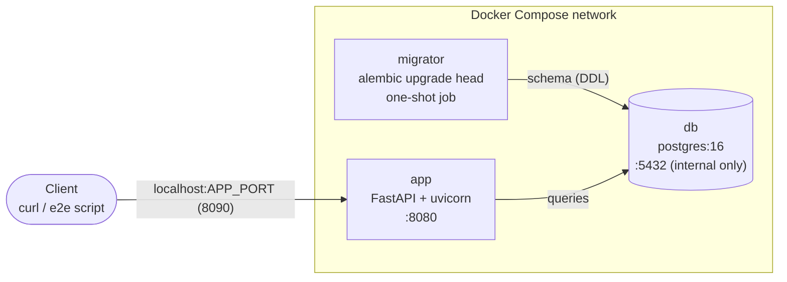
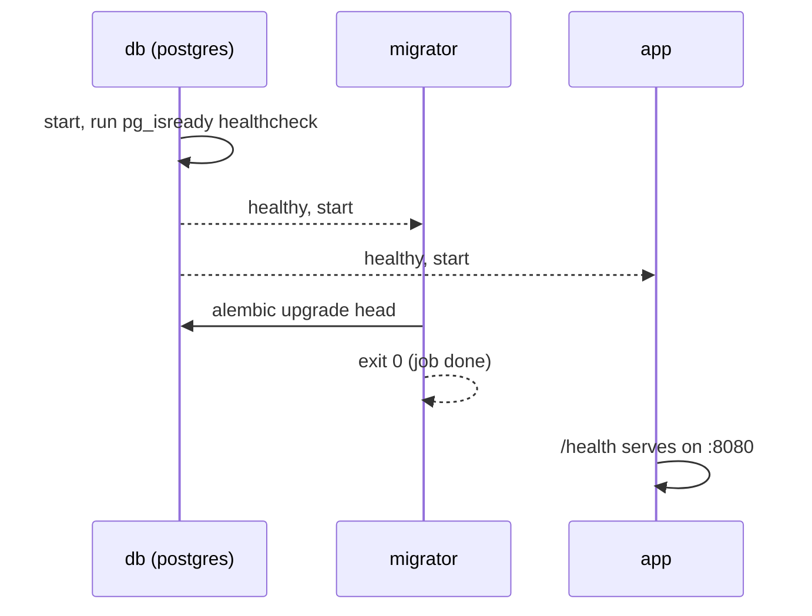

# Warehouse PO Reconciliation API

A FastAPI + PostgreSQL service that automates a **three-way match**: checking that what a company *ordered* (purchase order), what actually *arrived* (receipt), and what the vendor *billed* (invoice) all agree before anyone pays.

If you've never worked in a warehouse: a company orders 10 boxes of a product. The truck delivers 13, the packing slip says 10, and the invoice charges a higher price than agreed. Someone has to catch that before paying. This API records each document, compares them, and flags only the exceptions (overages, shortages, duplicates, price mismatches) so people review problems instead of every line.

## Data flow
1. Must exist
 - Vendor
 - Product
 - ProductVendor - the vendor item number may be different than the manufacturer id
2. PurchaseOrder
 - A purchase order is created and sent to a vendor for processing.
 - It would be best practice to have an existing PO before creating an invoice. In the event of a double shipment of a PO, a secondary PO must be created in order to receive the additional items.
 - Line Items containing items and quantities must be added to the PO and the PO sent to a Vendor before an Invoice or packing slip would be received.
3. Packing Slip with Lines
 - This is the fulfillment of an invoice. This could align with one or more POs or invoices
4. Receipt
 - A receiving associate would compare physically received items against the packing slip quantities, verifying item number and quantities.
 - A threshold of qty variance may be adjusted (default 2%) to auto reconcile or not. 
 - Variances beyond 2% difference will need manual approval by a different associate to verify the accuracy of the receipt and determine the end result of the discrepant product.
5. An invoice with lines is created against a specific PO or POs.
 - approved receipts will auto reconcile to the invoice. 
 - Price variances beyond 2% will be flagged for review.


## Architecture



Startup order:



| Service  | Role                                   | Ports                                   |
|----------|----------------------------------------|-----------------------------------------|
| db       | PostgreSQL 16, data in a named volume  | 5432, internal to the Compose network   |
| migrator | One-shot Alembic migration job         | none                                    |
| app      | FastAPI API served by uvicorn          | container 8080, published on `APP_PORT` |

Interactive API docs are at `http://localhost:<APP_PORT>/docs` once the stack is up.

## Running it

Prerequisites: Docker with Compose, Python 3.12 (for running pytest locally).

```bash
cp .env.example .env          # then edit values if you like
make up                       # validates compose file, builds, starts db + migrator + app
curl localhost:8090/health    # {"status":"ok"}  (use your APP_PORT)

python -m venv .venv && source .venv/bin/activate
pip install -r requirements.lock
make test                     # unit tests for the reconciliation rules
make e2e                      # 19-step end-to-end test against the running stack
```

`.env` needs `POSTGRES_USER`, `POSTGRES_PASSWORD`, `POSTGRES_DB` and `APP_PORT`.

Other targets: `make down`, `make logs`, `make lock` (regenerate `requirements.lock` from the built image), `make reset` (**deletes the database volume**).

## CI/CD

Defined in `.github/workflows/ci.yml`. It runs on every push and pull request.

**`test` job** (every push and PR)
1. Install pinned dependencies from `requirements.lock` and run `pytest`.
2. Generate a throwaway `.env` and validate the compose file (`docker compose config -q`).
3. Build and start the full stack, then wait for `/health`.
4. Run `scripts/endpoint_test.sh`, the end-to-end test, which exits non-zero on any failed check.
5. On failure, dump container logs.

**`publish` job** (only on `main`, only after `test` passes)
- Logs in to GitHub Container Registry with the built-in `GITHUB_TOKEN` (permissions limited to `packages: write`).
- Builds the image and pushes it to `ghcr.io/<owner>/<repo>` tagged with the commit SHA and `latest`.

## Design decisions and what broke

**Design decisions**
- **Receipts are compared to the packing slip, not the PO.** The slip is what the vendor claims they shipped, so that's the fair baseline for a count. A 2% tolerance (inclusive) auto-accepts normal variance; anything outside it, and any duplicate, goes to a human.
- **Physical reality and workflow are separate fields.** `is_overage` / `is_shortage` / `is_duplicate` describe what happened; `approval_status` (`auto | pending | approved | rejected`) describes what a person decided. A 13-vs-10 overage stays flagged as an overage even after someone approves keeping it.
- **Prices are snapshotted on the PO line.** Invoice lines are checked against the cost recorded at order time, not today's price list. Free items are handled explicitly (invoicing $0.00 for a $0.00 line is fine; billing $5.00 is flagged), and `is_problem` is computed on the server.
- **Alembic owns the schema** and runs as a one-shot `migrator` service, so schema changes are versioned and the app image never mutates the database on its own.

**What broke**
- **Dependency drift (the psycopg incident).** After an unrelated Dockerfile change, a `--no-cache` rebuild pulled a newer SQLAlchemy (2.1) whose default `postgresql://` driver became psycopg v3, and the app crashed on import with `No module named 'psycopg'`. Fix: name the driver explicitly (`postgresql+psycopg2://`, normalized in code), and install from a pinned `requirements.lock` so builds are reproducible.
- **A container that was "Up" but broken.** `uvicorn --reload` kept the process alive after the import failure, so `docker compose ps` looked fine; the image `HEALTHCHECK` reported `(unhealthy)`. The one-shot migrator also inherited that web healthcheck, which is the Job-vs-Deployment distinction in miniature.
- **Empty migrations.** Alembic autogenerate produced `pass` migrations because the models weren't imported in `alembic/env.py`.
- **Root-owned files.** Containers running as root wrote files into the bind-mounted repo. Fixed by running as a non-root user whose uid matches the host.

## Known gaps

- `app` waits for `db` to be healthy but not for `migrator` to finish. On a fresh database the first requests can race the migration. Fix: `depends_on: migrator: condition: service_completed_successfully`.
- Some foreign keys on `product` and `receipt` are not yet enforced.
- Deferred by design: tolerance policy table, vendor returns, FIFO receipt-to-invoice matching, authentication.

## Next

Phase 2 moves this to Kubernetes (kind): the migrator becomes a Job, `.env` becomes a ConfigMap and Secret, and the Dockerfile healthcheck becomes liveness and readiness probes.


