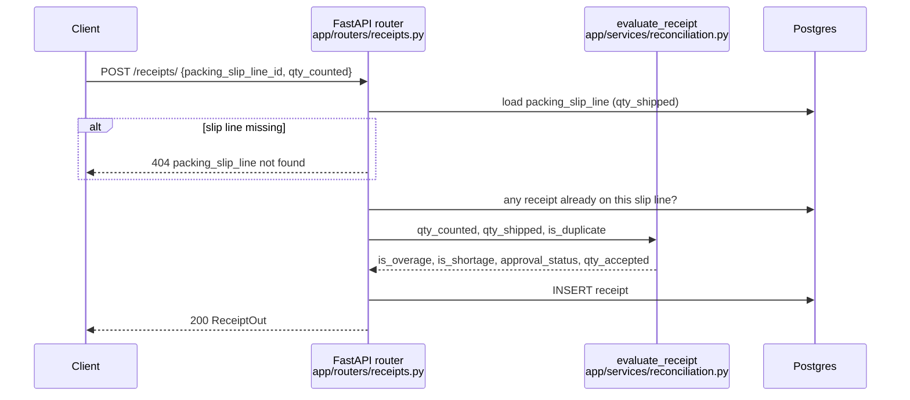

# How it works

A walkthrough for technical reviewers: what the service claims to do, how a request moves through it, and the evidence that each claim holds. Architecture diagrams, CI/CD and the Terraform network are in the [README](../README.md); this page links to them rather than repeating them.

## What it proves, in 30 seconds

The service does a **three-way match**: what was ordered (purchase order), what physically arrived (dock count compared with the vendor's packing slip), and what was billed (invoice). Lines that agree go through on their own. Only the exceptions are left for a person.

To reproduce, from a clean checkout:

```bash
cp .env.example .env
make up
make demo
```

`make demo` runs [`scripts/demo.sh`](../scripts/demo.sh). It resets the database, plays one scenario through the real API, and checks 23 claims against the HTTP responses and the database. It exits non-zero if any claim fails, so the output is evidence and not just a printout. Add `--pause` (`./scripts/demo.sh --pause`) to step through it act by act when presenting live.

## Request lifecycle

Recording a dock count, the core decision in the service:



Some design choices:
- **The rules are pure functions** in `app/services/reconciliation.py`, with no database or HTTP code. That's why they can be unit-tested in milliseconds and then proven again end to end.
- **The router does the I/O:** it loads the facts, calls the rule, and saves the result.
- **Invoice lines follow the same pattern.** `app/routers/invoice_lines.py` loads the PO line's snapshotted `cost`, and `evaluate_price` decides `is_problem`.

## Reconciliation rules

| Rule | Threshold | Result | Code | Unit tests (`tests/test_reconciliation.py`) |
|---|---|---|---|---|
| Count matches slip | variance ≤ 2% (inclusive) | `auto`, `qty_accepted = qty_counted` | `evaluate_receipt` | `test_exact_match_is_auto`, `test_shortage_at_tolerance_boundary` |
| Count outside tolerance | variance > 2% | `pending`, `qty_accepted = null` | `evaluate_receipt` | `test_overage_beyond_tolerance_is_pending`, `test_shortage_beyond_tolerance`, `test_shortage_just_past_tolerance_is_pending` |
| Over/short flags | any difference | `is_overage` / `is_shortage` set even when auto-accepted | `evaluate_receipt` | `test_overage_and_shortage_are_mutually_exclusive*` |
| Duplicate count | second receipt on the same slip line | `pending`, `is_duplicate`, even on an exact match | router + `evaluate_receipt` | `test_duplicate_forces_pending_even_on_exact_match` |
| Nothing shipped | `qty_shipped = 0` | treated as a 100% variance → `pending` | `evaluate_receipt` | `test_zero_shipped` |
| Review decision | receipt must be `pending` | `approved`/`rejected`; anything else → 400 | `decide_receipt` in `app/routers/receipts.py` | e2e step 13, demo act 5 |
| Invoice price | \|price − PO cost\| / PO cost > 2% | `is_problem = true` (over- or under-charge) | `evaluate_price` | `test_overcharge_*`, `test_undercharge_*`, `test_exact_price_match_is_not_a_problem` |
| Free item | PO cost is $0.00 | OK only if billed $0.00 | `evaluate_price` | `test_free_item`, `test_free_item_but_invoiced_anyway` |

## Annotated run

These excerpts are from an actual `make demo` run against the local stack, trimmed for length.

**Act 0: the platform is up and the schema is current.** Before touching business logic, the demo checks the infrastructure claims: the API container passes its Docker `HEALTHCHECK`, the one-shot migrator exited 0, and the database's `alembic_version` matches the latest migration in the repo.

```
app       Up 8 days (healthy)
db        Up 8 days (healthy)
migrator  Exited (0) 8 days ago
  ✔ API container reports healthy (Docker HEALTHCHECK on /health)
  ✔ migrator ran to completion and exited 0
  database at revision 07216d9b4c59, latest migration in repo is 07216d9b4c59
  ✔ database schema is at the latest Alembic revision
```

**Act 2: price snapshot.** The PO's nested lines are stored with the agreed cost. This is the number every invoice line is later checked against.

```
  → POST /purchase-orders/  4 lines: widget x10, bracket x10, hinge x10, bolts x50
  ← 200  id=1 status=created reconciliation_status=pending
  po_line_item.cost in the database: 12.50,8.00,4.25,0.80
  ✔ nested lines stored with their agreed cost
```

**Act 4: receiving.** Five dock counts against Acme's packing slip. Note the bolts: 51 of 50 is within the band, so it is auto-accepted, but `is_overage` still records what physically happened.

```
Bolts: shipped 50, counted 51 (2% over).
  ← 200  approval_status=auto qty_accepted=51 is_overage=true
  ✔ variance inside the 2% band is auto-accepted, but still marked as an overage

Brackets: shipped 10, counted 13.
  ← 200  approval_status=pending qty_accepted=null is_overage=true
  ✔ 30% overage is held for review, nothing accepted yet

Someone scans the widget line a second time.
  ← 200  approval_status=pending is_duplicate=true
  ✔ duplicate count is flagged and held, even though the quantity matches
```

**Act 5: human review, and the guard.** Approving the bracket overage records the decision. Trying to re-decide a receipt the system already auto-accepted is refused.

```
  → PATCH /receipts/3  {"approval_status": "approved", "qty_accepted": 13}
  ← 200  approval_status=approved qty_accepted=13 qty_quarantined=0 is_overage=true
  → PATCH /receipts/1  {"approval_status": "rejected"}
  ← 400  detail=receipt is 'auto', not awaiting review
  ✔ only pending receipts can be decided
```

**Act 6: invoice.** $8.12 against $8.00 (1.5%) passes; $4.75 against $4.25 (11.8%) is flagged.

```
  ← 200  price=8.12 is_problem=false
  ✔ small variance inside the 2% band passes
  ← 200  price=4.75 is_problem=true
  ✔ overcharge is flagged
```

**Act 7: the exception report.** Out of 5 dock counts and 3 billed lines, this is everything a person has to look at:

```
     kind     | id |   product    |           issue
--------------+----+--------------+---------------------------
 invoice line |  3 | Door hinge   | billed 4.75, PO says 4.25
 receipt      |  4 | Door hinge   | short: counted 6 of 10
 receipt      |  5 | Steel widget | duplicate count

  ✔ exactly 3 exceptions: short hinges, duplicate widget scan, hinge overcharge

All 23 claims checked against the live API and database. All passed.
```

**It fails when it should.** As a check on the demo itself, setting the receipt tolerance to 0% in `evaluate_receipt` makes the demo report the broken rule and exit 1:

```
  ✘ variance inside the 2% band is auto-accepted, but still marked as an overage -- approval_status: expected 'auto', got 'pending'; qty_accepted: expected '51', got 'null';
  ✘ exactly 3 exceptions: short hinges, duplicate widget scan, hinge overcharge -- expected '3', got '4'
2 of 23 claims failed.
```

## How it's verified

The same rules are checked at three levels:

1. **Unit tests:** 18 pure-function tests covering tolerance boundaries, duplicates, zero shipped, over- and undercharges, and free items. Run with `make test`.
2. **End-to-end:** [`scripts/endpoint_test.sh`](../scripts/endpoint_test.sh) runs 34 checks across every endpoint against the running stack. Run with `make e2e`.
3. **CI:** [`.github/workflows/ci.yml`](../.github/workflows/ci.yml) runs both on every PR and push to main. It runs the unit tests, builds the stack with Compose, waits for `/health`, runs the e2e script, and dumps container logs on failure. On main it then publishes the image to GHCR, tagged with the commit SHA. See [CI/CD](../README.md#cicd).

The demo and the e2e script share their request and assertion helpers ([`scripts/lib.sh`](../scripts/lib.sh)), so the demo exercises the same code path CI does.

## Platform pieces

- **Containers:** a multi-stage `Dockerfile` that runs as non-root uid 1000 and has a `HEALTHCHECK`. The Compose startup order is db (healthy) → migrator (completed successfully) → app. See [Architecture](../README.md#architecture).
- **Lessons that shaped it:** dependency drift fixed by a pinned `requirements.lock`, a container that showed "Up" while unhealthy, and the migrator inheriting the web healthcheck. See [Design decisions and what broke](../README.md#design-decisions-and-what-broke).
- **AWS:** a Terraform VPC across two availability zones, with public and private subnets, a NAT gateway, and S3 remote state. See [Infrastructure](../README.md#infrastructure-aws-terraform).

## Known gaps

- **No read endpoints.** Everything except `/health` creates or updates records. So the demo reads line ids and the exception report straight from Postgres, and says so where it does.
- **No authentication.** `created_by` and `approved_by` are plain integers.
- **Some foreign keys are not enforced** (on `product` and `receipt`). For example, a receipt's `po_line_item_id` is not validated.
- **The 2% tolerance is hardcoded** rather than read from a per-vendor policy table.
- **Not deployed to AWS yet.** Only the network exists; RDS and compute come next (see [Next](../README.md#next)).
